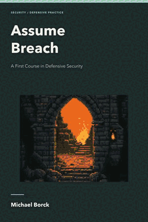
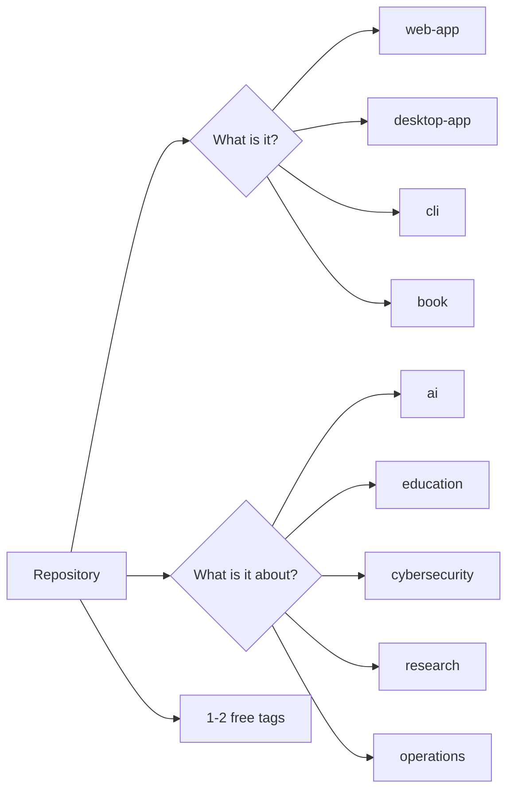

# Michael Borck

<!-- BADGES:START -->
            
<!-- BADGES:END -->

University lecturer, maker, and occasional sky-watcher. I build educational tools, run the LocoLab local-LLM research lab, restore vintage 3D printers, and spend too much time staring through telescopes.

## 🔭 What I Do

- **Teaching** — Business programming, Cybersecurity, and AI literacy
- **Consulting** — AI literacy, governance & data sovereignty for Australian regulated small businesses
- **Building** — Desktop apps and CLI tools for educators
- **Research** — Local LLMs on consumer hardware (LocoLab)
- **Making** — 3D printer restoration and astronomy at 8020workshop.com

## 🚀 Start here

| I am a... | Start with |
|-----------|------------|
| Educator | [tools.borck.education](https://tools.borck.education), [programminglabs.borck.education](https://programminglabs.borck.education), [teach.borck.education](https://teach.borck.education) |
| Student | [programming.borck.education](https://programming.borck.education), [hands-on-ai](https://michael-borck.github.io/hands-on-ai/), [security.borck.education](https://security.borck.education) |
| Researcher | [research.borck.dev](https://research.borck.dev), [locolabo.org](https://locolabo.org), [greatsilence.borck.education](https://greatsilence.borck.education) |
| Client | [borck.consulting](https://borck.consulting), [teach.borck.education](https://teach.borck.education) |

## 📍 Now

- Building LocoLab on consumer hardware
- Writing The Human Edge
- Teaching the ISYS unit family

Updated November 2026

## ⭐ Popular repositories

| Repository | What it is |
|------------|------------|
| [study-buddy](https://github.com/michael-borck/study-buddy) | Offline AI tutoring app with local models |
| [netsim](https://github.com/michael-borck/netsim) | Browser-based network simulator with real Linux syntax |
| [talk-buddy](https://github.com/michael-borck/talk-buddy) | Conversation practice with an AI partner |
| [slide-stream](https://github.com/michael-borck/slide-stream) | Turn Markdown and PowerPoint into narrated videos |
| [ethical-hacking-docker-labs](https://github.com/michael-borck/ethical-hacking-docker-labs) | Containerised ethical hacking labs |
| [gh-toolkit](https://github.com/michael-borck/gh-toolkit) | Audit, tag, and present GitHub repositories |

## 📚 Books

Open-access books and textbooks on AI, programming, and security. Browse all at [books.borck.education](https://books.borck.education).

Animated covers

🌐 Around the Web

> **Start at [bigpicture.borck.dev](https://bigpicture.borck.dev)** — the map that ties my AI teaching, tools, and research together.

| Site | What it is |
|------|------------|
| [borck.dev](https://borck.dev) | Calling card / portfolio landing |
| [resume.borck.dev](https://resume.borck.dev) | 11 résumés from one YAML |
| [borck.consulting](https://borck.consulting) | AI literacy, governance & data-sovereignty consulting |
| [borck.education](https://borck.education) | Hub for my teaching properties |
| [teach.borck.education](https://teach.borck.education) | Workshops, courses & executive education |
| [programming.borck.education](https://programming.borck.education) | Learn to build software in the AI era |
| [programminglabs.borck.education](https://programminglabs.borck.education) | Speak Software: twelve labs where you describe, an agent builds, and specification, verification, decomposition, and taste are the curriculum. |
| [tools.borck.education](https://tools.borck.education) | Free, private AI tools for your classroom |
| [hands-on-ai](https://michael-borck.github.io/hands-on-ai/) | Your AI learning lab: six small, readable modules for chat, RAG, agents, workflows, loops, and evals. |
| [aitoys.borck.education](https://aitoys.borck.education) | AI Toys: small pages that break a misconception |
| [security.borck.education](https://security.borck.education) | Self-contained security labs that run on your laptop |
| [books.borck.education](https://books.borck.education) | My books & textbooks |
| [greatsilence.borck.education](https://greatsilence.borck.education) | Six frames for thinking about artificial intelligence at civilisational scale, borrowed from the search for aliens |
| [research.borck.dev](https://research.borck.dev) | Links to my research projects |
| [simulations.borck.education](https://simulations.borck.education) | Physics & science simulations |
| [8020workshop.com](https://8020workshop.com) | Maker blog & opinions |
| [retroverse.studio](https://retroverse.studio) | Indie game studio |

🧪 LocoLabo — local AI on modest hardware

[**locolabo.org**](https://locolabo.org) is an independent, self-funded applied AI research lab in Perth, Australia. It studies what local AI can do on secondhand hardware and builds tools that keep student and organisational data on-premises.

The work starts from a constraint: many institutions cannot send student work to cloud AI. LocoLabo builds the alternative, and studies the pedagogical position that follows: **Conversation, not Delegation**. Small local models are not a compromise for brainstorming, iteration, and critical dialogue. They are the right tool, and they keep the human thinking.

The lab's work spans routed specialist models, VRAM-tier benchmarking, multi-GPU inference, simulated organisations for professional rehearsal, thinking-partner evaluation, and agentic scaffolding for small models.

[Read more at locolabo.org](https://locolabo.org)

🏷️ How I tag repositories

I use nine standard tags, split into two questions:

| Question | Tags |
|----------|------|
| What is it? | `web-app`, `desktop-app`, `cli`, `book` |
| What is it about? | `ai`, `education`, `cybersecurity`, `research`, `operations` |

A repo can answer both. A teaching web app about AI gets `web-app`, `education`,
and `ai`. Free tags add the specifics, such as `quarto`, `docker-labs`, or
`interactive-simulation`.

📦 Browse by Topic

| Topic | Repos | Description |
|-------|-------|-------------|
| [`web-app`](https://github.com/michael-borck?tab=repositories&q=topic:web-app) | 128 | Websites, static sites & web apps |
| [`desktop-app`](https://github.com/michael-borck?tab=repositories&q=topic:desktop-app) | 25 | Desktop applications |
| [`cli`](https://github.com/michael-borck?tab=repositories&q=topic:cli) | 40 | Command-line & developer tools |
| [`book`](https://github.com/michael-borck?tab=repositories&q=topic:book) | 31 | Books, textbooks & Quarto projects |
| [`ai`](https://github.com/michael-borck?tab=repositories&q=topic:ai) | 109 | AI, ML & LLM projects |
| [`education`](https://github.com/michael-borck?tab=repositories&q=topic:education) | 144 | Teaching, course & assessment materials |
| [`cybersecurity`](https://github.com/michael-borck?tab=repositories&q=topic:cybersecurity) | 27 | Security labs & forensics |
| [`research`](https://github.com/michael-borck?tab=repositories&q=topic:research) | 31 | Research projects & papers |
| [`operations`](https://github.com/michael-borck?tab=repositories&q=topic:operations) | 10 | Private operating workspaces & indexes |
| [`teaching`](https://github.com/michael-borck?tab=repositories&q=topic:teaching) | 50 | Free tag: course delivery & teaching practice |
| [`curtin`](https://github.com/michael-borck?tab=repositories&q=topic:curtin) | 20 | Free tag: Curtin University materials |
| [`presentation`](https://github.com/michael-borck?tab=repositories&q=topic:presentation) | 19 | Free tag: workshops, seminars & talks |
| [`maker`](https://github.com/michael-borck?tab=repositories&q=topic:maker) | 5 | Free tag: astronomy, 3D printing & hardware |

## 🤝 Work with me

- Academic: [michael.borck@curtin.edu.au](mailto:michael.borck@curtin.edu.au)
- Professional: [michael@borck.dev](mailto:michael@borck.dev)
- Website: [borck.dev](https://borck.dev)
- Consulting: [borck.consulting](https://borck.consulting)
- Workshops and executive education: [teach.borck.education](https://teach.borck.education)
